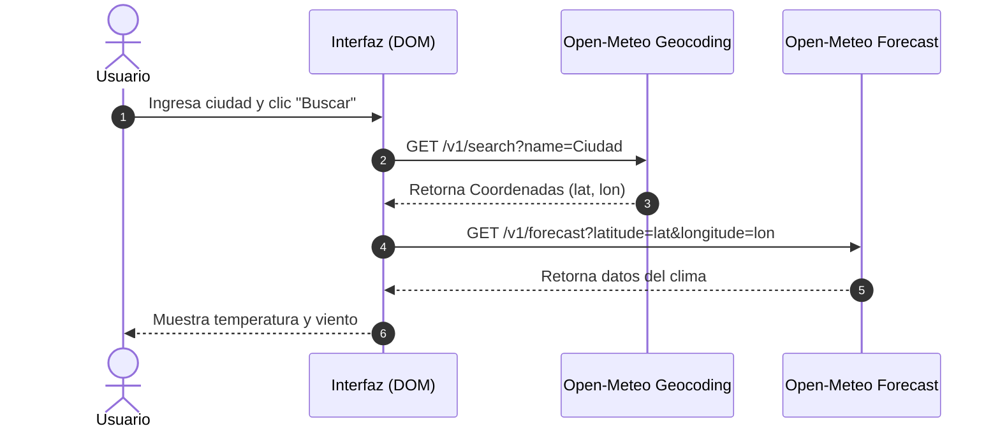

# Evaluación 03 - Diseño de Interfaces de Programación Avanzado

**Alumno:** Delgado Navarro Jhon Anthony  
**Deploy GitHub Pages:** [Ver Demo Online](https://jhondelgado.github.io/evaluacion03-js/)

---

## Tabla de Contenidos
1. [Pregunta 1: Gestor de Pedidos (DOM)](#pregunta-1)
2. [Pregunta 2: JS Moderno y Módulos](#pregunta-2)
3. [Pregunta 3: Consumo de APIs (Fetch / Async)](#pregunta-3)
4. [Bitácora de Uso de IA](#bitácora-de-uso-de-ia)
5. [Conclusión Técnica](#conclusión)

---

## Pregunta 1
Se construyó el módulo `p1-dom/` aplicando delegación de eventos en `#lista-pedidos` y renderizado seguro con `createElement` y `textContent` para erradicar vulnerabilidades XSS.

---

## Pregunta 2
Refactorización del cálculo utilizando `reduce()`, encadenamiento opcional `?.` y operador `??`.
Al intentar abrir con el protocolo `file://`, la consola devuelve un error de CORS porque el navegador prohíbe importar módulos ES de forma local sin un servidor como Live Server.

---

## Pregunta 3

### Diagrama de Secuencia (Mermaid)

---

## Bitácora de Uso de IA

| # | Pregunta | IA usada | ¿Qué propuso la IA? | Decisión | ¿Por qué? |
| - | -------- | -------- | ------------------- | :------: | --------- |
| 1 | P1 | Gemini | Renderizar con `innerHTML` directo. | Corregió | Vulnerable a ataques XSS. Se cambió a `textContent` y `createElement`. |
| 2 | P1 | Gemini | Agregar `addEventListener` a cada botón. | Corregió | Ineficiente dinámicamente. Se usó delegación de eventos con `.closest()`. |
| 3 | P2 | Gemini | Usar `||` para dar valor por defecto a la cantidad. | Corregió | El valor `0` es *falsy* y se sobrescribía. Se reemplazó por `??`. |
| 4 | P2 | Gemini | Usar `export default` en todos los archivos. | Corregió | Se prefirió `export` nombrado para un autocompletado claro y modularidad limpia. |
| 5 | P3 | Gemini | Usar `Promise.all` directamente. | Corregió | Si una ciudad falla, cae todo. Para manejo de fallos individuales conviene `Promise.allSettled`. |
| 6 | P3 | Gemini | Suponer que `fetch()` lanza error con 404/500. | Corregió | `fetch()` solo falla ante problemas de red. Se debió evaluar manualmente `response.ok`. |

---

## Conclusión

En esta evaluación se implementaron soluciones robustas enfocadas en la seguridad y el rendimiento de las aplicaciones en JavaScript. Para la manipulación del DOM se priorizó el uso de `textContent` frente a `innerHTML` para prevenir ataques de inyección de código (XSS), garantizando el tratamiento de entradas de usuario de forma segura. La adopción de la delegación de eventos permitió optimizar el consumo de memoria mediante la asignación de un único listener. En la refactorización a ES6+, se identificó la vulnerabilidad lógica del operador `||` al procesar valores falsy legítimos como el número cero, corrigiéndolo eficazmente con el operador de fusión nula (`??`). En la interacción con peticiones asíncronas, se constató empíricamente la superioridad de `Promise.all` sobre las ejecuciones secuenciales con `await`, logrando reducir sustancialmente los tiempos de espera en llamadas HTTP independientes. Finalmente, la integración del control explicito sobre `response.ok` demostró ser crítica, ya que el API Fetch nativo no rechaza promesas ante códigos de estado HTTP 4xx o 5xx.
